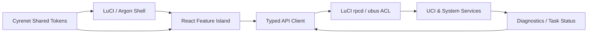

<!--
SPDX-FileCopyrightText: 2026 Cyrenet OS Contributors
SPDX-License-Identifier: Apache-2.0
-->

# Cyrenet OS — UI 与前端设计规范（UIDESIGN.md）

> **文档类型**：产品界面设计系统与前端工程规范（Design System & Frontend Architecture）  
> **项目**：Cyrenet OS / A Ripple of Connection.  
> **版本**：Design Specification 1.0 / Draft for Implementation  
> **日期**：2026-11-22  
> **适用范围**：Cyrenet Core、Standard、Extended；x86_64 首发，架构不绑定特定硬件  

## 0. 设计决策摘要（必须先读）

Cyrenet OS 的目标是：**拥有商业网络产品级别的一致性和完成度，同时保留 ImmortalWrt/OpenWrt 原生的透明、可靠、可维护性。** 整套 UI 必须遵守 KISS：信息充分但不堆砌、功能丰富但默认不打扰、外观精致但不牺牲排障效率。

**本项目明确采用两套不同的 UI 实现体系，共享一套 Cyrenet Design Tokens：**

| 责任 | 技术与名称 | 实现边界 |
|---|---|---|
| **A. LuCI/Argon 主题层** | `luci-theme-cyrenet`，Fork Argon 3.x | 登录页、顶栏、侧边导航、原生 LuCI 页面外观、第三方 LuCI 页面兼容、全局主题模式 |
| **B. Cyrenet 原创功能 UI 层** | React + TypeScript + **shadcn/ui** + Tailwind CSS + Vite | DNS Center、Diagnostics、Backup、Updater、Performance、IPv6 Service Center、自研 Dashboard 的业务组件 |
| **C. 共享视觉契约** | `cyrenet-tokens`（CSS 变量及设计文档） | 颜色、字体、栅格、圆角、阴影、图表、状态语义、深浅模式 |
| **D. 系统接口层** | LuCI/ubus/rpcd/UCI；必要时采用独立受限的后端适配器 | 权限、数据获取、配置读写、操作审计、任务进度与错误处理 |

**不得混淆：** Argon 是 LuCI 的主题实现；shadcn/ui 是 React 组件源码集合，**不是 LuCI 原生主题，也不能直接贴入 LuCI JS View 使用**。两者视觉统一，但在代码、构建链、权限和生命周期上保持隔离。V1 不重写 LuCI 整站为 React SPA，也不额外部署常驻 Node.js 前端服务器。

**决策优先级**：网络安全与恢复能力 > 行为正确性 > 可读性与无障碍 > 一致性 > 性能 > 视觉装饰。

### 0.1 参考设计的使用边界

本规范参考所提供设计文档的组织结构（Overview / Colors / Typography / Layout / Elevation / Components / Responsive / Do's & Don'ts），**不复制其 Claude/Anthropic 品牌**。其奶油黄底色、珊瑚色主色、商业字体、专属 Logo、营销站巨幅标题和页面分区节奏均不是 Cyrenet OS 的设计要求。

Cyrenet 的品牌色由此前项目决策确定：**低饱和粉紫、浅紫、冰蓝；深色模式采用墨紫与柔和高亮紫**。UI 服务于真实网络设备管理界面，不采用营销官网的视觉密度。

---

## 1. 产品体验与信息架构

### 1.1 产品个性

- **Calm / 克制**：反馈明确，不用大面积高饱和色证明“科技感”。
- **Precise / 准确**：WAN、DNS、PPS、IPv6、备份、升级状态均有真实来源；未知不伪装为正常。
- **Reassuring / 可恢复**：危险操作有变更摘要、前置检查、回滚与恢复指引。
- **Familiar / 原生友好**：用户能在主题界面与原生 LuCI 之间自由切换，不丢失已有管理路径。
- **Layered / 分层**：初学者看到清晰操作，高级用户可展开日志、UCI 差异与原始指标。

### 1.2 顶层导航与归属

| 一级菜单 | 核心页面 | UI 归属 |
|---|---|---|
| Overview | 状态概览、系统与网络摘要 | 新 Dashboard：shadcn/ui；LuCI 传统状态页保留 |
| Network | 接口、VLAN、路由、DHCP、防火墙 | 现有 LuCI/第三方：Argon |
| Network → Services | IPv6 服务发布、外网可达性 | 自研：shadcn/ui |
| Services | AdGuard Home / Adblock Fast / SmartDNS / Tailscale / OpenClash | 第三方原页面：Argon；统一编排中心：shadcn/ui |
| Performance | 实时吞吐、PPS、SQM、转发模式 | 自研：shadcn/ui；原插件配置仍可进入 LuCI |
| Diagnostics | 自检、故障时间线、导出报告 | 自研：shadcn/ui |
| System | OTA、备份、配置迁移 | 自研：shadcn/ui |
| System → Advanced | 原生 LuCI 设置、软件包、日志与 SSH 指引 | 原生 LuCI：Argon |

**导航规则：** LuCI 菜单仍是唯一导航入口与权限过滤来源；React 自研模块不得再画一套永久的左侧导航、重复登录页或全局顶栏。自研页面内部可使用 Tabs、Breadcrumb、局部子导航。

**按 Profile 显示：** Core / Standard / Extended 未安装的功能不展示空菜单；无权限的用户不应仅靠前端隐藏按钮，后端也必须拒绝操作。

### 1.3 信息优先级

1. 当前联网是否正常；如果异常，故障在哪一层。
2. 哪个服务正在工作、是否影响整体网络。
3. 当前具体发生了什么（操作进度、错误原因、最近变更）。
4. 用户下一步可以做什么。
5. 只有进入高级视图后，才展示更细的内核与命令级细节。

页面的常见结构：`标题 + 一句话用途 + 当前状态 + 主要操作 + 关键指标/配置 + 高级细节/日志`。禁止无意义的“欢迎使用”“探索更多”大横幅挤占网络状态信息。

---

## 2. 双层 UI 架构与责任边界

### 2.1 层 A：基于 Argon 的 LuCI 外壳

**定位：** `luci-theme-cyrenet` 由 Argon 上游源码 Fork，负责登录、菜单、布局、全站基础风格和传统 LuCI 页面兼容。优先延续 Argon 的现有机制，不大规模侵入 OpenWrt LuCI 源码。

**允许修改：**

- Logo、favicon、项目名、版本信息与登录页面品牌元素。
- 主题色、字体栈、背景、边框、圆角、状态色、明暗模式。
- 侧栏、顶栏、菜单层级表现、移动端折叠与页面留白。
- 兼容传统 LuCI 表单、表格、通知、对话框与第三方应用的 CSS。
- 主题设置页、主题状态同步接口和必要的共享 token 桥接。

**不负责：**

- 实现 DNS 引擎切换、OTA 校验、配置备份或系统诊断业务逻辑。
- 在 Argon 模板中塞入大量 React 业务组件。
- 强行重写所有第三方插件的 HTML 与 JS。
- 将第三方插件视觉兼容等同于其功能兼容。

**降级要求：** `luci-theme-cyrenet` 损坏时仍能通过系统提供的其他可用 LuCI 主题或 SSH 维护系统。主题更新不得破坏网络服务。

### 2.2 层 B：采用 shadcn/ui 的自研功能页面

**定位：** 所有 Cyrenet 自编写的**功能性管理 UI**，优先使用 React + TypeScript + shadcn/ui，复用统一组件和交互模式，避免每个功能模块重新发明一套按钮、弹窗和表格。

候选应用及主要组件：

| 自研模块 | 建议包名 | 核心 UI 组件 |
|---|---|---|
| Dashboard | `luci-app-cyrenet-dashboard` | Card、Tabs、Badge、Chart、Skeleton、Tooltip |
| DNS Center | `luci-app-cyrenet-dns` | RadioGroup、Select、Switch、AlertDialog、Form、Table |
| Firmware Updater | `luci-app-cyrenet-updater` | Stepper（自实现）、Progress、Alert、Dialog、Accordion |
| Backup Center | `luci-app-cyrenet-backup` | Checkbox、Table、Command、Dialog、Input、Progress |
| Diagnostics | `luci-app-cyrenet-diagnostics` | Tabs、Table、Accordion、Badge、ScrollArea、Copy |
| IPv6 Service Center | `luci-app-cyrenet-network` | Form、Combobox、DataTable、Dialog、Tooltip |
| Performance Center | `luci-app-cyrenet-performance` | Chart、Tabs、Switch、Alert、Slider（有限使用） |

以上是**规划中的包与组件**，不是已经实现的 OpenWrt 软件包。组件名称对应 shadcn/ui 中已有组件或由现有组件组合的复合组件（例如 Stepper 需要实现/验证）。

**约束：** shadcn/ui 仅是可复制、可维护的组件源码。必须锁定依赖版本并纳入仓库，不能在设备运行时从远端安装组件、加载 npm 或连接公共 CDN。

### 2.3 运行时集成方式（推荐）

首选 **LuCI Shell + React Feature Islands**：

1. LuCI 原有登录、认证、导航和页面路由保持不变。
2. 某个自研 LuCI 页面加载后，在其内容区域创建**唯一挂载节点**（例如 `#cyrenet-app-root`）。
3. 由 LuCI View/模板负责从本地固件文件加载预构建的 JS、CSS 静态资源。
4. React 在该节点内 `createRoot()`，只渲染当前功能页面，不接管整个网站。
5. 页面通过独立的 Typed API Client 请求 rpcd/ubus/UCI 数据；权限由后端 ACL 保护。
6. 离开页面时按加载机制卸载组件、移除订阅/轮询，避免路由切换后内存泄漏。

**编译时**：Vite/Node.js 仅在 CI 或开发者电脑运行，产出静态 JS/CSS；路由器上只运行既有 uhttpd/LuCI 体系和必要系统服务，**不运行 Node.js 服务器**。

**工程验证项**：LuCI View 加载 Vite 构建资产的方式、动态 `import()`、CSP、hash 文件名与资源引用基路径、浏览器兼容及 LuCI 版本差异，必须先通过最小 POC 再投入全部自研页面。不把上述集成细节假定为已经完成。

备选路径：若 React Islands 对特定 LuCI/Argon 版本无法稳定集成，则可将自研模块作为**同源的独立静态页面**加载，在保留会话与权限验证的前提下跳转或受控嵌入；需额外处理导航与 CSP，不能绕过认证。**禁止直接在固件上增设一套无必要的独立 Web 管理服务器。**

### 2.4 两层之间只共享“视觉与能力”，不共享 UI 实现

- **共享**：颜色 token、字体、间距、圆角、图表语义、图标规范、明暗主题、状态词汇、统一数据格式。
- **Argon 专属**：LuCI 模板、主题 CSS、原生表单 CSS、传统插件页面适配。
- **React 专属**：shadcn/ui 组件源代码、Tailwind 生成样式、React Hooks、客户端状态管理与数据展示。
- **系统专属**：rpcd ACL、UCI、系统服务脚本、任务执行与日志。

不能用全局 CSS 强行“把所有 LuCI 表单改成 shadcn 样式”，也不能因为 shadcn 组件看起来好看，就抛弃第三方插件的原生页面。

---

## 3. Cyrenet Design Tokens：唯一视觉真源

### 3.1 颜色哲学

色彩语义是：**雾白 / 柔和紫**作为结构和主要操作，**淡粉**用于品牌情绪点缀，**冰蓝**用于信息与非危急网络指标，**绿/琥珀/红**只用于真正的运行状态。

- 主要按钮用可读性足够的**深紫色**，而非低对比度的浅粉色。
- 普通卡片不使用大面积紫粉渐变；彩色只在需要强调的少数位置出现。
- 危险操作永远用危险语义色，而不是用品牌粉紫色装饰。
- 趋势图颜色有稳定语义：例如下载为冰蓝、上传为紫色，同一个系列跨页面不变。
- 所有颜色均通过 token 使用，禁止在业务组件到处写十六进制值。

### 3.2 Light Tokens（设计基线）

| Token | HEX | 用途 |
|---|---|---|
| `canvas` | `#FAF9FE` | 页面背景，略带紫调的近白色 |
| `surface` | `#FFFFFF` | 卡片、弹窗与工作区 |
| `surface-soft` | `#F4F0FB` | 次级背景、浅色区域 |
| `surface-raised` | `#FBFAFF` | 轻微提升的面板 |
| `sidebar` | `#F7F4FC` | 侧边导航 |
| `border` | `#E6E1F0` | 1px 描边与分隔线 |
| `foreground` | `#272238` | 标题、主要文字 |
| `body` | `#3A354B` | 正文 |
| `muted-foreground` | `#615B73` | 说明、次要文字 |
| `primary` | `#7653B4` | 主操作、当前选中态 |
| `primary-hover` | `#68469F` | 主操作悬停 |
| `primary-foreground` | `#FFFFFF` | 主按钮文字 |
| `brand-pink` | `#D69BCA` | 品牌点缀、背景图形 |
| `brand-purple-soft` | `#E9DDF7` | 轻品牌背景 |
| `brand-ice` | `#A6C8EB` | 非文本冰蓝点缀 |
| `info` | `#326DA9` | 信息状态、可读信息链接 |
| `success` | `#277B5D` | 已连接、通过 |
| `warning` | `#95621A` | 待处理、风险 |
| `danger` | `#B73951` | 失败、破坏性操作 |
| `focus-ring` | `#7653B4` | 键盘焦点环 |

备注：浅粉与冰蓝不能直接充当白底小字号正文色；彩色 UI 元素需验证文本与背景的真实对比度。

### 3.3 Dark Tokens（设计基线）

| Token | HEX | 用途 |
|---|---|---|
| `canvas` | `#13121D` | 深墨紫页面背景 |
| `surface` | `#1C1A29` | 卡片与弹窗 |
| `surface-soft` | `#272438` | 次级内容区 |
| `surface-raised` | `#302C41` | 浮层与悬停区 |
| `sidebar` | `#191725` | 侧边导航 |
| `border` | `#39344A` | 描边与分隔 |
| `foreground` | `#F6F3FC` | 主要文字 |
| `body` | `#E2DBEE` | 正文 |
| `muted-foreground` | `#BAB2CC` | 次要文字 |
| `primary` | `#CDB1F6` | 主操作与选择态 |
| `primary-hover` | `#DFC9FD` | 主操作悬停 |
| `primary-foreground` | `#1F1631` | 浅紫按钮上的深色文字 |
| `brand-pink` | `#F0B2DC` | 品牌点缀 |
| `brand-purple-soft` | `#3A3150` | 品牌次级背景 |
| `brand-ice` | `#A2C8EF` | 冰蓝信息点缀 |
| `info` | `#9AC8F1` | 信息状态 |
| `success` | `#78D6A3` | 正常 |
| `warning` | `#E8BE7F` | 风险 |
| `danger` | `#FC9AAB` | 错误与危险 |
| `focus-ring` | `#D9C2FA` | 键盘焦点环 |

### 3.4 CSS 变量实现契约

推荐**以 `--cn-*` 作为源 token 命名空间**；Argon 主题 CSS 与 React/shadcn 样式都从这里映射，避免分别硬编码两套视觉主题。

以下为实现样例（不是完整生产 CSS）：

```css
/* shared/tokens/cyrenet.css — 两层复用；由最终构建流程分发 */
:root[data-cyrenet-theme="light"] {
  --cn-canvas: #FAF9FE;
  --cn-surface: #FFFFFF;
  --cn-surface-soft: #F4F0FB;
  --cn-sidebar: #F7F4FC;
  --cn-border: #E6E1F0;
  --cn-foreground: #272238;
  --cn-muted-foreground: #615B73;
  --cn-primary: #7653B4;
  --cn-primary-foreground: #FFFFFF;
  --cn-brand-pink: #D69BCA;
  --cn-brand-ice: #A6C8EB;
  --cn-success: #277B5D;
  --cn-warning: #95621A;
  --cn-danger: #B73951;
  --cn-focus-ring: #7653B4;
}
:root[data-cyrenet-theme="dark"] {
  --cn-canvas: #13121D;
  --cn-surface: #1C1A29;
  --cn-surface-soft: #272438;
  --cn-sidebar: #191725;
  --cn-border: #39344A;
  --cn-foreground: #F6F3FC;
  --cn-muted-foreground: #BAB2CC;
  --cn-primary: #CDB1F6;
  --cn-primary-foreground: #1F1631;
  --cn-brand-pink: #F0B2DC;
  --cn-brand-ice: #A2C8EF;
  --cn-success: #78D6A3;
  --cn-warning: #E8BE7F;
  --cn-danger: #FC9AAB;
  --cn-focus-ring: #D9C2FA;
}
/* 为 shadcn/ui 建立 scoped semantic aliases，保证变量不污染原生 LuCI */
.cyrenet-ui-root {
  --background: var(--cn-canvas);
  --foreground: var(--cn-foreground);
  --card: var(--cn-surface);
  --card-foreground: var(--cn-foreground);
  --popover: var(--cn-surface);
  --popover-foreground: var(--cn-foreground);
  --primary: var(--cn-primary);
  --primary-foreground: var(--cn-primary-foreground);
  --secondary: var(--cn-surface-soft);
  --secondary-foreground: var(--cn-foreground);
  --muted: var(--cn-surface-soft);
  --muted-foreground: var(--cn-muted-foreground);
  --accent: var(--cn-surface-soft);
  --accent-foreground: var(--cn-foreground);
  --destructive: var(--cn-danger);
  --border: var(--cn-border);
  --input: var(--cn-border);
  --ring: var(--cn-focus-ring);
  --radius: 0.75rem;
}
```

**注意**：shadcn/ui 实际版本还可能要求 `--destructive-foreground`、`--chart-*`、`--sidebar-*`、`--color-*` 等 token。最终由锁定版本的组件源码与 Tailwind v4 `@theme inline` 补齐，不能直接把上面的片段当作完整样式表使用。对话框、Popover 等 Portal 内容如果挂载在 `document.body`，要**把 Portal container 放在 `.cyrenet-ui-root` 内**，或提供明确的主题变量继承机制，否则浮层会丢失样式与主题。

### 3.5 shadcn/ui 与 Tailwind 映射

- 推荐 React + TypeScript、Vite、Tailwind CSS v4 与 shadcn/ui，实际版本在 M0 的 POC 中锁定。
- `components.json` 使用 `rsc: false`、`tsx: true`、`cssVariables: true`；组件源文件纳入版本控制。
- 使用 shadcn/ui 的**语义类**如 `bg-background`、`text-foreground`、`border-border`，而不是写死 `bg-purple-500`。
- Tailwind v4 存在前缀机制（例如 `prefix(cn)` 对应 `cn:flex`）；**是否使用前缀以 shadcn CLI 生成结果和 LuCI 兼容性测试为准**。不能只改 CSS 前缀而不处理组件源码中的 class 名。
- **必须避免 Tailwind Preflight 全局重置 LuCI 的 `html`、`body`、`button`、`input`、`table`**。推荐限制重置范围、作用域化输出的组件 CSS；若采用非前缀式方案，需针对现有 LuCI/Argon 做回归测试。
- 所有自研 CSS 尽量作用于 `.cyrenet-ui-root`。不把全局 `:root` 下的 shadcn 默认 token、按钮样式或 `h1` 规则覆盖到 LuCI 页面。
- 若使用 Shadow DOM 做隔离，需额外验证字体、Portal、主题继承和焦点管理；不视为无成本方案。

### 3.6 明暗模式的单一真源

Argon 是**全站主题状态的唯一权威来源**。Cyrenet 不再保存第二个相互独立的深浅模式设置。

要求：

1. Argon/用户系统偏好 → 解析为 `light` 或 `dark`。
2. 桥接层将结果同步到 `data-cyrenet-theme` 及 React 根节点需要的 `.dark` 状态。
3. React 自研页面监听主题状态变化，同步刷新图表、Portal、Editor、Tooltip 等。
4. 首次渲染前尽量确定主题，避免刷新时从亮色闪到暗色。
5. 如果 Argon 的具体主题状态事件/类名变化，改适配层，不在每个业务组件里做独立检测。

**不允许：** Argon 为暗色而 DNS Center 为亮色；一个组件私自存储永久主题偏好导致不同页面状态相互冲突。

---

## 4. Typography 字体规范

### 4.1 字体策略

运行时不依赖远程字体 CDN。优先采用系统字体，并可选打包获许可的开源字体子集；必须覆盖简体中文、英文、数字、IP、MAC 与日志内容。

- **UI Sans**：`Inter`（如内置并确认许可）/ `Noto Sans SC` / `PingFang SC` / `Microsoft YaHei` / system-ui / sans-serif。
- **数值与日志 Mono**：`JetBrains Mono`（如内置并确认许可）/ `SFMono-Regular` / `Consolas` / monospace。
- **品牌展示字体**：仅 Logo/官网等少数位置可选风格字体；管理后台正文、表格和数据不使用装饰性衬线字体。

不使用源参考文档提到的私有商业字体 Copernicus、StyreneB，亦不复制其商标符号。

### 4.2 字体层级

| 语义 | 字号 / 行高 | 字重 | 使用场景 |
|---|---|---|---|
| Page title | 24px / 32px | 600 | 页面唯一主标题 |
| Section title | 18px / 26px | 600 | 卡片分组、二级区域 |
| Card title | 15–16px / 22px | 600 | 卡片内标题 |
| Body | 14px / 22px | 400 | 表单说明、常规内容 |
| Strong body | 14px / 22px | 500 | 核心标签、重要字段 |
| Data primary | 22–28px / 30–36px | 600 | 带宽、CPU、运行时间等主要数值 |
| Table | 13–14px / 20px | 400/500 | 配置与统计表格 |
| Caption | 12px / 18px | 400/500 | 单位、更新时间、辅助信息 |
| Code / Log | 12–13px / 20px | 400 | 终端、日志、JSON、配置差异 |

管理后台不是营销官网，不采用 64px 巨幅标题。正文尽量不小于 14px；只有辅助标签和数据密集型日志允许使用 12–13px。表格数字使用 `font-variant-numeric: tabular-nums`；IP/MAC/端口/哈希/时间统一强调可复制性和不自动截断的可读性。

---

## 5. Layout、间距与视觉层级

### 5.1 间距刻度

4px 作为基础单位。固定常用值：`4 / 8 / 12 / 16 / 20 / 24 / 32 / 40 / 48px`。不要每个页面单独发明 `17px`、`23px` 之类的随机间距。

| 项目 | 推荐值 |
|---|---|
| 页面内容最大宽度 | 1440px（允许数据表格利用更宽空间） |
| 桌面端页面左右留白 | 24–32px |
| 移动端左右留白 | 12–16px |
| 卡片内边距 | 16–24px |
| 页面模块间距 | 24–32px |
| 卡片内元素间距 | 8–16px |
| 控件常规高度 | 40px；紧凑表格最少 36px |
| 触控目标 | 优先至少 44×44px |
| 主要卡片圆角 | 12px |
| 按钮/输入圆角 | 8px |
| 大型弹窗圆角 | 16px |

### 5.2 Surface 与阴影

- 页面 `canvas`、卡片 `surface`、嵌套区 `surface-soft` 构成主要层次。
- 优先使用 1px 边框和背景差异；阴影只用于浮层和弹窗，杜绝每张卡片都有强阴影。
- 卡片不以彩色边框表示普通状态。危险或失败状态使用清晰文本、图标和少量颜色。
- 图表可以使用低透明度渐变填充，但绝不牺牲数据线可读性。

### 5.3 Grid

- 监控摘要优先采用 4 列 / 2 列 / 1 列响应式网格。
- 复杂设置表单尽量单栏，双栏只用于短字段且保持阅读顺序。
- 长表格优先保留列标题、过滤和横向滚动；移动端可切换记录详情视图，不把列压缩成无法阅读的几像素。
- 大规模列表应按需分页、虚拟化或限制采样窗口；禁止所有日志一次性渲染到 DOM。

---

## 6. Argon 主题层详细规范

### 6.1 视觉范围

`luci-theme-cyrenet` 需要实现：

1. 左侧导航、顶栏、面包屑、页脚及系统状态区域的品牌统一。
2. 登录页 Logo、背景、表单与错误提示。
3. LuCI 原生表格、表单、按钮、选项卡、提示与弹窗的颜色、字体、圆角和间距映射。
4. 常见第三方 LuCI 应用的基础可读性与暗色适配。
5. 宽屏、窄屏、触屏下导航的可用性。
6. 中英文与动态长文案的布局兼容。

**不要**为了“统一”而修改插件私有 DOM 结构，或使用过度宽泛的 `!important` 覆盖整个 LuCI。

### 6.2 登录页

- 默认浅色/深色布局均可访问；登录前遵循系统偏好或用户可控的主题模式。
- Logo 简洁，优先涟漪/星轨的原创抽象图形，不使用游戏角色官方立绘。
- 登录表单是视觉焦点，背景只可轻度渐变或抽象线条，不使用会降低对比度的高细节壁纸。
- 失败信息明确；不透露用户名是否存在。
- 键盘 Enter 可提交，密码输入有可访问的显示/隐藏控制。

### 6.3 顶栏与侧栏

- 所有 Profile 使用同一布局。
- 当前菜单项的活动态由 `primary` + 低饱和背景 + 明确文字共同表现，不只靠颜色区别。
- 标题旁可以显示固件 Profile 与通道，但不能用过度醒目的彩色徽章装饰每个菜单。
- 移动侧栏关闭后焦点返回触发按钮；展开时避免背景页面继续被误操作。

### 6.4 第三方 LuCI 插件兼容

建立回归页面清单，至少包含：LuCI 原生 Network/Firewall、AdGuard Home LuCI 入口（若存在）、OpenClash、SmartDNS、Tailscale、SQM、DDNS、UPnP、Statistics。

**只承诺主题层兼容**（文字、表单、浮层、表格、布局、明暗模式）；业务功能兼容需另行验收。第三方插件如果使用 iframe 或自带 WebUI，不强制改成 Cyrenet 样式。

### 6.5 维护策略

- Fork 固定 Argon 上游 tag/Commit，不直接追踪不稳定的最新 `master`。
- 将品牌改动集中在独立的 token、布局与少量兼容补丁中，尽量减少大面积源码差异。
- 将上游变更、冲突、测试结果写入 `docs/specs/upstream-argon.md`。
- 在升级 Argon 版本时执行视觉回归与功能兼容测试，尤其是登录、菜单、移动端、原生系统更新对话框。

---

## 7. shadcn/ui 自研功能层详细规范

### 7.1 技术选型

- React + TypeScript，打包工具 Vite。
- shadcn/ui（源码进入仓库）作为组件基础；Tailwind CSS v4 提供 utility 与 token 映射。
- 图标优先 `lucide-react`，需要跨 LuCI 层一致时使用同一图标语义映射。
- 图表优先 shadcn/ui Chart 所用方案或经过容量评估的兼容库，必须支持实时数据、主题色和无障碍摘要。
- API 类型由后端接口契约生成或严格定义，避免每个页面各写一套无类型 fetch。
- 不引入 SSR、Next.js 或路由器端 Node.js；简单 React Islands 不需要完整前端微服务架构。

### 7.2 组件标准

| 组件 | 用途 | 额外要求 |
|---|---|---|
| Button | 确认、运行测试、保存 | 主按钮每个操作区尽量唯一；危险操作独立语义 |
| Input / Textarea | 配置、备注、地址输入 | 即时格式校验，不在输入中途丢失焦点 |
| Select / Combobox | 网口、DNS 引擎、设备 | 未获取选项时显示加载/不可用 |
| RadioGroup / Switch | DNS 模式、开关服务 | 开关与“已生效”状态区别显示 |
| Card | 指标与分组 | 优先信息密度和对齐，不为装饰而套多层卡片 |
| Table / DataTable | 服务列表、指标 | 排序、筛选、复制、空状态、批量操作明确 |
| Tabs | 主要模式、诊断分类 | 切换不丢失尚未提交的表单内容 |
| Dialog / AlertDialog | 表单、危险确认 | 按风险等级选择，防止误提交 |
| Progress / Skeleton | 上传、固件下载、异步任务 | 不能伪造进度；未知进度显示不确定状态 |
| Alert / Toast / Sonner | 成功、失败、警告 | 重要错误需保留在页面而非仅瞬时 Toast |
| Badge | 连接、模式、通道 | 只用于少量真正需要强调的状态 |
| Tooltip / Popover | 指标解释、帮助 | 不能是访问关键内容的唯一渠道 |
| Chart | WAN、PPS、SQM、历史指标 | 有单位、时间范围、缺失值语义和文字摘要 |

### 7.3 组件状态

所有交互组件至少覆盖：

- Default / Hover / Focus-visible / Pressed。
- Disabled（说明禁用原因）。
- Loading（是否允许取消、是否可重复提交）。
- Success / Warning / Error。
- Empty / No permission / Unsupported / Offline / Timeout。

尤其对于网络管理，**“获取失败”不等于“数值为 0”，“未安装”不等于“服务已关闭”，“启动命令返回成功”不等于“服务已健康”**。

### 7.4 交互规范

**读取操作**：明确数据新鲜度与最后采样时间；网络断线时显示“数据已过期”。可见页面轮询间隔和隐藏页面的暂停策略需统一管理。

**配置操作**：编辑 → 本地表单校验 → 服务端预检 → 显示配置差异/影响 → 提交 → 后端确认 → 刷新真实状态。

**危险操作**（更新固件、重置、防火墙入站放行、DNS 接管、WAN 参数应用）：必须有清晰标题、风险说明、变更摘要；支持恢复机制时展示恢复路径。不能仅靠 Toast 告知用户失败。

**日志**：按照“摘要 → 可展开细节 → 复制/导出”递进。默认隐藏密钥、Token 和凭据；复制原始敏感日志必须再确认。

**实时指标**：每个卡片标注单位（Mbps、pps、ms、℃、%）、采样时间与数据来源；图表不能因数据缺失将曲线跳到 0 误导用户。

### 7.5 业务页面结构

#### Dashboard

- 第一屏：WAN 连通状态、PPPoE 在线时间、IPv4/IPv6、实时上下行、设备数量、CPU/内存、DNS 模式、固件版本。
- 第二屏：实时流量曲线、PPS/丢包、服务健康、异常摘要。
- 第三屏：最近事件及深入诊断入口。
- 依据硬件能力隐藏/标记不可用指标，不展示虚假的 N5105 专属数据。

#### DNS Center

- 顶部：当前工作模式（AdGuard Home / Adblock Fast / 无过滤）、健康情况及上游 DNS。
- 中部：引擎选择、规则订阅与统计；SmartDNS 链路仅在可用时出现。
- 底部：切换预检、监听端口、服务冲突、可恢复日志。
- 引擎切换必须显示“准备中 / 应用中 / 验证中 / 生效 / 回滚中 / 失败”流程；不把“按钮点了”当作切换成功。

#### Firmware Updater

- 展示当前版本、Profile、通道、目标架构、远端版本和变更日志。
- 依次显示：检查更新 → 获取清单 → 签名验证 → 下载与校验 → 兼容性预检 → 备份 → 用户确认 → 执行升级。
- 升级开始前警告网络可能中断；重启后通过重新连接与版本检查确认结果。
- UI 不承诺未实现的自动回滚。

#### Backup Center

- 三个视图：备份列表、导出配置、导入/恢复。
- 可按网络、DNS、防火墙、服务、主题、软件包清单选择内容。
- 密钥与凭据默认被保护，备份加密提示清楚。
- 跨版本恢复展示兼容性报告与配置差异，不以“导入成功”替代“服务工作正常”。

#### Diagnostics

- 分类：接口、拨号、IPv4、IPv6、DNS、防火墙、服务、性能。
- 状态：通过 / 异常 / 不可用 / 未检测，显示证据及下一步操作。
- 生成报告前展示脱敏说明，可预览或选择导出内容。

#### IPv6 Service Center

- 以“服务”为主要概念，而不是要求用户直接写复杂防火墙表达式。
- 每项服务包含目标主机、协议、端口、来源范围、DDNS、检测状态。
- 对公网开放权限必须明确确认；不允许无意间开放 PVE 8006 或 SSH 管理端口。

#### Performance Center

- 首屏显示真实 Mbps、PPS、SoftIRQ、丢包、Conntrack 等。
- 切换模式前展示与 SQM、软件 Flow Offloading、多拨、特殊内核构建的兼容关系。
- “吞吐优先”“低延迟优先”必须有可见的实际配置差异，不能是无解释的营销预设。

---

## 8. 系统 API、权限与任务状态

### 8.1 数据流



Mermaid 描述的是**目标架构**，并不代表所有通信端点已经实现。

### 8.2 安全契约

- 统一使用 LuCI 会话与受保护的系统 API；不把持久管理 Token 塞进 localStorage。
- 操作权限由 rpcd ACL/后端执行器进行**服务端验证**，不是只隐藏按钮。
- POST/修改请求遵守现有 LuCI CSRF 与会话保护机制；细节以当前目标版本的接口为准。
- 任务执行通过受限的后端方法触发，不允许前端把用户任意字符串直接拼接为 Shell 命令。
- 重要操作返回稳定的任务标识、进度状态、错误码和可见日志；任务状态要能跨页面刷新查询（以实际后端实现为准）。
- 导出配置、上传备份、OTA 镜像等接口必须有大小、类型、校验和权限限制。
- 前端/日志中不得无意输出 PPPoE 密码、Tailscale 密钥、OpenClash 订阅和其他敏感数据。

### 8.3 API 状态模型

建议统一定义：

```ts
type RemoteState<T> =
  | { status: 'idle' }
  | { status: 'loading'; previous?: T }
  | { status: 'ready'; data: T; observedAt: string }
  | { status: 'stale'; data: T; observedAt: string; reason: string }
  | { status: 'unsupported'; reason: string }
  | { status: 'forbidden'; reason: string }
  | { status: 'error'; code: string; message: string };
```

复杂操作另有 `pending / validating / applying / verifying / succeeded / rolling_back / failed` 等任务状态，并要求状态由后端实际执行进度支持，不在前端自行假设“已成功”。

---

## 9. 图标、插画、图表与动效

### 9.1 图标

- 主组件使用 Lucide，线条统一、20px 常规尺寸，信息密度高时 16px。
- 同一语义始终使用同一图标；例如连接、告警、下载、备份、回退、DNS。
- 图标不得代替文字传递核心状态。尤其不要仅用红/绿小圆点表示连接成功与失败。

### 9.2 插画与品牌素材

- Logo 使用原创涟漪/星轨抽象形态，保证 16px favicon 仍可辨认。
- 登录页允许非常轻的光晕、波纹或渐变，但不得降低表单可读性。
- 不复制《崩坏：星穹铁道》人物立绘、UI 素材和游戏商标；品牌灵感不意味着官方关联。
- 禁止以照片、复杂粒子背景或持续动画占满仪表盘。

### 9.3 图表

| 数据 | 推荐视觉 | 颜色原则 |
|---|---|---|
| 下载速率 | 线图 / 面积图 | 冰蓝 |
| 上传速率 | 线图 / 面积图 | 紫色 |
| CPU / 内存 | 单值 + 细趋势 | 中性或品牌主色，不默认用红绿 |
| 错包 / 丢包 | 折线 / 表格 | 异常才使用警告/错误语义 |
| 设备流量 | 排序条形图 | 类别色，保持可区分 |
| DNS 命中 / 拦截 | 柱状图 / 比例 | 带文字图例，避免只靠颜色 |
| OTA 进度 | 阶段 + 真实进度 | 非线性/未知进度需标注 |

完整指标必须有数量级、单位、时间范围、采样频率、最新样本时间与缺失数据处理规则。

### 9.4 动效

- 常规交互 120–180ms；大型抽屉与对话框 180–240ms。
- 动效只用于状态转变和层级变化，不以反复跳动来吸引注意。
- 遵守 `prefers-reduced-motion`；可减少或禁用不必要过渡。
- 实时图表不因每次网络采样触发整页重排。

---

## 10. 响应式与无障碍

### 10.1 断点

| 区间 | 行为 |
|---|---|
| 小屏 `<640px` | 单栏布局、导航抽屉、表单全宽、表格可横向滚动或转详情视图 |
| 中屏 `640–1023px` | 2 列摘要、折叠导航、主要操作优先展示 |
| 大屏 `1024–1439px` | 3–4 列摘要、常规侧栏与内容并列 |
| 宽屏 `≥1440px` | 最大内容宽度与合理分栏，不无限拉长正文 |

Argon 层原有断点可保留，React 层必须与其实际内容区宽度适配；**不能只看视口宽度，还要考虑侧栏占用空间**。

### 10.2 可访问性要求

- 文本和背景普通正文对比度目标 ≥ 4.5:1；大字与非文本控件状态目标 ≥ 3:1（以 WCAG AA 为最低验收参考）。
- 每个输入框有程序可识别的 Label，错误信息关联到对应字段。
- 所有核心流程可键盘操作；Tab 顺序合理，焦点位置可见。
- 对话框打开后焦点进入、关闭后返回来源；危险操作不能仅依赖键盘快捷键。
- 状态、告警、成功与否同时使用文字，不只靠颜色和图标。
- 深浅主题、200% 浏览器缩放与移动触控均必须完成可用性测试。
- 确认图表有文字摘要或表格备选，不把运维关键信息锁在折线颜色里。

---

## 11. 国际化、时间与数据格式

- 首发支持简体中文与英文；语言从 LuCI 设置继承，模块不得另有永久不一致的语言设置。
- 统一数据单位：网络实时速率明确区分 `Mbps` 与 `MB/s`；PPS 为 `pps`，时延为 `ms`；流量累计明确表示 `GB`、`GiB` 的选择。
- IP、MAC、IPv6 前缀、端口、版本、SHA256 使用等宽样式并支持复制。
- 时间戳按设备时区展示并能查看 ISO/UTC 原始时间；避免将服务器时间错误当成用户浏览器时间。
- UI 不依赖固定文本长度；警告、按钮、表头要为多语言预留空间。

---

## 12. 源码组织与输出产物

建议目录（可在 M0 POC 后微调）：

```text
cyrenet-os/
├── PROJECT.md                  # V1.0 产品与技术设计基线（冻结）
├── DESIGN.md                   # 工程技术契约与跨模块接口约定
├── UIDESIGN.md                 # UI 与前端设计规范（本文件）
├── docs/
│   ├── adr/                    # 架构决策记录（含 ADR-0002 双层 UI 架构决策）
│   └── specs/
│       └── upstream-argon.md   # Argon 上游变更与回归记录
├── design/
│   ├── tokens/                 # 色板、字体、间距、状态与 CSS token 来源
│   └── assets/                 # 原创 Logo、favicon、插画（仅提交有分发权的资产）
├── themes/
│   └── luci-theme-cyrenet/     # Argon Fork，LuCI Shell/传统页面
├── ui/
│   ├── package.json
│   ├── components.json
│   ├── vite.config.ts
│   └── src/
│       ├── components/ui/     # 已入库的 shadcn/ui 组件源文件
│       ├── components/cyrenet/ # 组合业务组件：状态卡/诊断结果/危险确认
│       ├── features/          # dashboard, dns, updater, backup, diagnostics ...
│       ├── lib/api/           # 类型化 rpcd/ubus API Client
│       ├── lib/theme/         # Argon → Cyrenet 主题桥
│       └── styles/            # scoped Tailwind 和 shadcn token 映射
├── packages/
│   ├── luci-app-cyrenet-dashboard/
│   ├── luci-app-cyrenet-dns/
│   ├── luci-app-cyrenet-updater/
│   ├── luci-app-cyrenet-backup/
│   ├── luci-app-cyrenet-diagnostics/
│   ├── luci-app-cyrenet-network/
│   └── luci-app-cyrenet-performance/
└── tests/
    ├── visual/
    ├── accessibility/
    ├── integration/
    └── security/
```

**构建产物契约**：CI 先完成 React/Vite 静态构建，再将产出的固定本地静态资源放入对应 `luci-app-cyrenet-*` 的安装路径。固件中不携带 `node_modules`、源码 map（除受控 debug 构建外）、前端开发服务器或构建工具链。资源路径、hash 清单和缓存策略必须通过 LuCI 版本测试。

**部署方式细节需要 POC 固化**：例如将静态资源安装到 `www/luci-static/cyrenet/`，由对应 LuCI 页面挂载引用；最终安装路径以 OpenWrt 软件包构建规范为准，不直接照搬开发目录。

---

## 13. 自动化设计与工程质量门槛

### 13.1 视觉回归

至少覆盖：

- Argon 主题：登录、Dashboard 外壳、原生网络表单、Firewall、软件包页、OpenClash LuCI 页面、移动侧栏。
- React 主题：Dashboard、DNS 引擎切换、OTA、备份恢复、诊断、IPv6 服务发布。
- 每个页面：Light / Dark × Desktop / Mobile × Ready / Loading / Error / Unsupported。
- 额外覆盖：超长 IPv6、超长路由器名称、中文/英文、无外网、插件未安装、权限不足。

### 13.2 浏览器兼容

以现代 Chromium、Firefox 和 Safari 为主要目标；Tailwind CSS v4 对旧浏览器存在特定最低版本要求。必须建立明确支持矩阵，不能假定所有家庭旧设备浏览器都能正常渲染。

### 13.3 安全与交互验收

1. 自研页面无法越权调用 rpcd 方法，ACL 从服务端生效。
2. React CSS 不破坏原生 LuCI 页面及 Argon 顶栏/侧栏。
3. 原生 LuCI 样式不破坏 React 组件的 Dialog、Popover、Focus Ring。
4. 明暗模式切换不会造成亮屏闪烁、输入数据丢失或图表错误配色。
5. DNS 引擎切换失败能恢复旧配置，并明确显示失败原因。
6. OTA 进度必须来自真实任务状态，不出现虚假成功。
7. 配置备份的敏感字段不会在 Toast、Console、诊断输出中泄漏。
8. 窄屏可完成所有重要操作；键盘可完成关键配置流程。
9. 无公网、无 CDN、断开 GitHub 的条件下仍可使用本地管理界面。
10. 主题或某个自研模块故障不能导致路由器整体不可管理。

### 13.4 性能预算（初始目标，需实测）

- 单个自研页面首次主线程初始化应保持响应，避免加载无关 Profile 的全部模块。
- React 资源按功能分包；共享依赖可复用，但不能把全部业务页面打成一个巨大入口。
- 图表历史样本需限量；对 24 小时以上高频数据使用下采样。
- 默认没有背景视频、持续粒子动画或高频全页面重新渲染。
- 建议为每次发布记录打包体积、加载时间、首屏交互延迟和主要接口耗时，基于 PVE 测试 VM 与低功耗浏览器实测设定最终阈值。

---

## 14. Do / Don't：开发约束

### Do

- 先明确页面属于 Argon Shell 还是 React 功能 UI，再选择组件体系。
- 用 `--cn-*` 和语义色变量维护统一视觉；一次修改可覆盖两个 UI 层。
- 优先保证有用、可读、可恢复的网络管理流程。
- 所有数据展示真实状态、单位、时间与来源。
- 引入 shadcn/ui 时将必要的组件源码版本化，并复审更新。
- 维护对原生 LuCI 和第三方 LuCI 页面的兼容性。
- 保持离线可用、深浅一致、键盘可达和安全的操作确认。

### Don't

- 不把 Argon 视为可直接运行 shadcn/ui 的 React 框架。
- 不把 React 应用扩展成第二套全站登录/菜单/会话机制。
- 不用全局 Tailwind 重置破坏 LuCI 表单与第三方应用。
- 不把奶油珊瑚配色、Claude 专属字体、标志照搬为 Cyrenet 品牌。
- 不为了“统一风格”重写成熟第三方插件的整个 UI。
- 不把成功启动命令当作服务健康，不把采集失败当成 0。
- 不在路由器上运行仅用于构建前端的 Node.js/npm/Vite。
- 不默认从外部 CDN 加载字体、组件或图表库。
- 不允许页面美观程度凌驾于 DNS、防火墙、OTA 与恢复的可靠性。

---

## 15. 分阶段实施与验收

| 阶段 | 任务 | 交付门槛 |
|---|---|---|
| **D0：设计基线** | 锁定品牌 token、字体、间距、图标、状态语义 | 本 DESIGN.md + token 初稿，色彩对比初检 |
| **D1：UI 集成 POC** | 在 ImmortalWrt/LuCI/Argon 页面内挂载最小 React + shadcn Button/Card/Dialog | 主题同步、CSS 隔离、LuCI ACL、资源加载均通过 |
| **D2：Argon Fork** | 主题配色、Logo、菜单、登录、原生表单兼容 | 桌面/移动 × 深/浅视觉回归通过 |
| **D3：React 组件层** | shadcn 基础组件、业务复合组件、API 客户端、状态体系 | Story/示例页覆盖主要状态与错误场景 |
| **D4：关键页面** | Dashboard、DNS Center、Diagnostics、Backup、Updater | 真实 API 状态、危险操作确认和错误恢复可验证 |
| **D5：高级功能** | IPv6 Service、Performance、Extended 指标与额外集成 | Profile 识别正确、未安装功能不误显示 |
| **D6：发布验收** | 视觉、无障碍、安全、断网、故障、OTA 综合回归 | 稳定发布门槛全部满足，未通过项明确阻断发布 |

**关键里程碑：D1 必须先于 D3–D5。** 如果 LuCI 与 React/shadcn 集成的样式隔离、主题同步、会话权限不能稳定通过，必须调整集成路径，而不是继续在不可维护的基础上堆功能。

---

## 16. 未定事项（技术验证，不是产品需求反复）

1. 固定采用的 Argon 3.x 具体 tag/Commit（`manifests/upstream.lock.yaml` 当前暂定锁定 `luci-theme-argon` `v3.1.4` / `c5c0873e122dc767c7ab0198c8bffc6e952b5cfb`，最终以 D1/M2 ImmortalWrt 25.12 集成测试为准）。
2. shadcn/ui、React、Vite、Tailwind 的最终锁定版本及许可证清单。
3. LuCI 页内动态加载 Vite hash assets 的安装路径和 CSP 方案。
4. Tailwind 前缀、Preflight 禁用/作用域化的最终技术实现。
5. Theme Bridge 的事件与 CSS class 适配方式（取决于 Argon Fork）。
6. Portal、弹窗层级和焦点管理在 LuCI 容器内的兼容性。
7. 实时图表方案、采样策略与大列表性能预算。
8. Logo/字体资产的原创、许可与体积审查。

以上事项应在 `docs/adr/` 中记录 ADR（Architecture Decision Record，参见 `ADR-0002`），写明候选方案、验证结果和决定，不允许未经实测在文档中宣称完成。

## 17. 技术资料

- Argon LuCI Theme：<https://github.com/jerrykuku/luci-theme-argon>
- OpenWrt LuCI example：<https://github.com/openwrt/luci/tree/master/applications/luci-app-example>
- LuCI example structure：<https://git.openwrt.org/project/luci/tree/applications/luci-app-example/structure.md>
- shadcn/ui Vite：<https://ui.shadcn.com/docs/installation/vite>
- shadcn/ui Theming：<https://ui.shadcn.com/docs/theming>
- shadcn/ui Components config：<https://ui.shadcn.com/docs/components-json>
- Tailwind CSS v4 upgrade guide：<https://tailwindcss.com/docs/upgrade-guide>
- ImmortalWrt：<https://github.com/immortalwrt/immortalwrt>

> **最终约束**：`Argon 统一壳层 + shadcn/ui 统一原创功能 UI + Cyrenet 统一视觉 token + 原生 LuCI/rpcd/UCI 可信后端`。用户感知到的是**一个系统**，代码实现仍保持清晰的职责边界。
